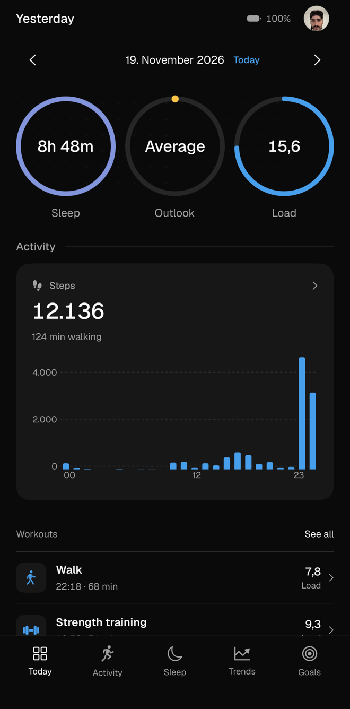
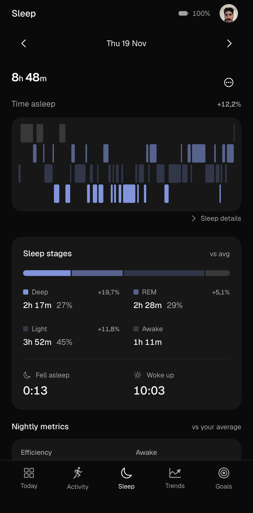
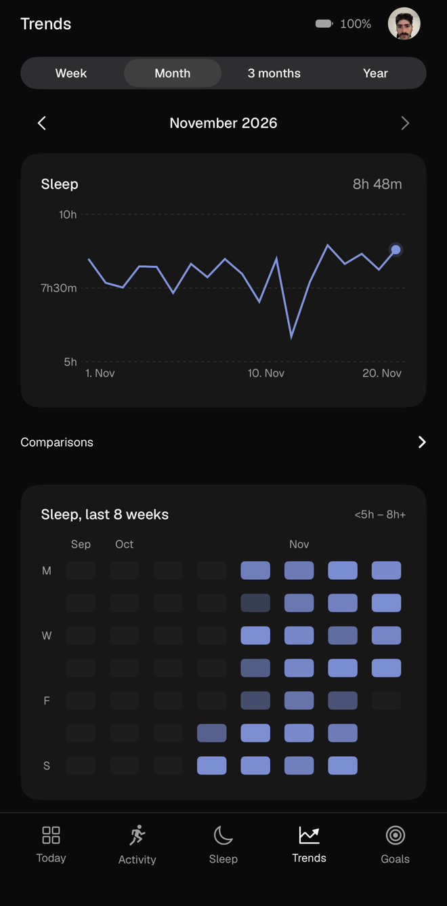

# Zoop


**Your wearable data, on your own server.**

Zoop collects recordings from your WHOOP and keeps them on your own server.
Explore sleep, recovery, activity and weight through the iPhone app and web dashboard.
Keep the original data, export it, and rerun analysis as the software improves.

[Self-hosting](docs/SELF_HOSTING.md) · [iPhone setup](docs/IPHONE_SETUP.md) ·
[Web dashboard](web/README.md) · [Contributing](CONTRIBUTING.md)

<p align="center">
  
  
  
  
</p>
<p align="center"><sub>Current app UI, captured in the simulator with sample data.</sub></p>

## What you can do

- Explore sleep stages, nightly measurements and your daily Recovery index.
- Review detected workouts, daily steps and training load.
- Track weight and cut, bulk or maintenance goals.
- Correct sleep and workouts while keeping the original recordings.
- Sync with Apple Health and export weight as CSV.
- Try manual ECG on WHOOP MG in development builds.
- Share selected charts through revocable links with optional passwords and expiry.

## Get started

You need three things:

- **Band:** WHOOP 5.0 or MG.
- **Phone:** an iPhone on iOS 17+ with Zoop installed.
- **Server:** a machine running Docker with Compose v2.

The server is required; the phone keeps an upload queue during connection outages.

```sh
git clone https://github.com/MakisChristou/zoop.git
cd zoop
./tools/setup.sh
docker compose up -d --build --wait
./tools/setup.sh --show-code
```

Open **http://localhost:8080** and create your admin account using the setup code.
Then connect the [iPhone app](docs/IPHONE_SETUP.md). See [self-hosting](docs/SELF_HOSTING.md)
for LAN access, accounts, backups and updates. Choose your own proxy or VPN.

Zoop is not on the App Store yet. For now, [build the iPhone app](docs/IPHONE_SETUP.md#build-from-source)
with a Mac, Xcode and an Apple development team with HealthKit support.
Docker builds the server; you do not need Rust or Node installed.

## How it works

| Component | Technology | Source |
| --- | --- | --- |
| iPhone | SwiftUI, CoreBluetooth, SQLite | `App/`, `Packages/` |
| Server | Rust, PostgreSQL | `server/` |
| Web | React, TypeScript, Recharts | `web/` |
| Website and docs | Docusaurus, Markdown | [`site/`](site/README.md) |

The phone collects recordings. The server stores them and computes the metrics
shown by both clients. Accounts keep each person's data private; administrators
see operational statistics without access to other people's health records.

Health estimates are not medical diagnoses. Zoop is independently implemented
and is not affiliated with WHOOP. Public interoperability research informs the
strap protocol; other projects' protocol code is not bundled.

[Contribute](CONTRIBUTING.md) · [Report a vulnerability](SECURITY.md) · [MIT license](LICENSE)
