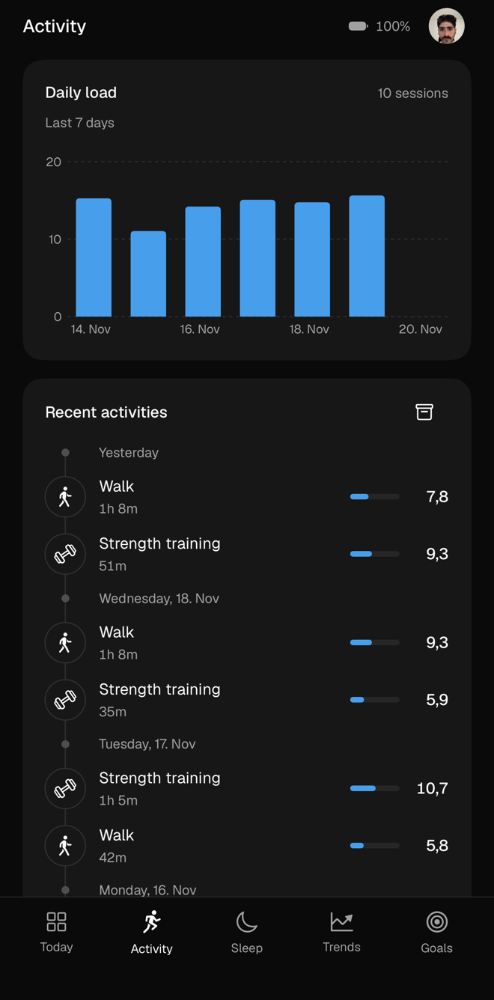

# Zoop


**Your strap. Your data. Your server.**

Zoop is an independent iPhone app for WHOOP 5.0 and WHOOP MG. It connects directly
over Bluetooth and turns your strap’s data into sleep, activity and health trends.
It exists so you can use your hardware with software you control, backed by a
self-hosted [Zoop API](https://github.com/MakisChristou/zoop-api).

<p align="center">
  
  
  
  
</p>

<p align="center"><sub>Captured on iPhone with real data, shared with permission.</sub></p>

## What it does

- Sleep timelines, stages and nightly measurements.
- Detected workouts, steps and activity history.
- Weight tracking, goals and weekly progress.
- Optional Apple Health sync and battery reminders.
- Experimental manual ECG recording on WHOOP MG.

Zoop is actively developed. Its estimates and experimental features are not
intended for medical diagnosis. It is not affiliated with or endorsed by WHOOP.

## How it works

The app is built with **SwiftUI, CoreBluetooth and SQLite**, with an independently
implemented Swift strap protocol. It saves sensor frames locally and retries uploads
until your server confirms receipt. Zoop API handles analysis; the app displays the
results alongside live readings.

Zoop uses the Bluetooth bond created by the official WHOOP app. Pair your strap
there first, then quit that app before connecting with Zoop. Day-to-day syncing uses
your own server, not the WHOOP cloud.

## Why a backend?

Zoop requires a self-hosted backend. It keeps one history for the iPhone and
[web app](https://github.com/MakisChristou/zoop-web), and can rerun improved analysis
on stored recordings while preserving your corrections.

| Approach | Trade-off |
| --- | --- |
| **Zoop** | Shared history and server-side analysis; you run the server. |
| [NOOP](https://github.com/ryanbr/noop) | Local storage and analysis; no server required. |
| [Goose variants](https://github.com/tigercraft4/goose) | Local-first, with an optional self-hosted backend. |
| [Official WHOOP](https://www.whoop.com/) | Managed service with proprietary analysis. |

A backend makes history easier to share and reprocess—not inherently more accurate.
The phone still handles Bluetooth collection; uploads queue during outages.

## Run it

You need Xcode 16+, [XcodeGen](https://github.com/yonaskolb/XcodeGen), an iPhone
running iOS 17+, and a running [Zoop API](https://github.com/MakisChristou/zoop-api).
Use an Apple development team with HealthKit signing support.

```sh
git clone https://github.com/MakisChristou/zoop.git
cd zoop
cp Config/Local.xcconfig.example Config/Local.xcconfig
```

Set your team ID and unique bundle ID in `Config/Local.xcconfig` (gitignored), then:

```sh
xcodegen generate
open Zoop.xcodeproj
```

Choose the **Zoop** scheme and your iPhone, then Run. Enter your API URL and bearer
token during setup. The simulator can preview the UI but cannot connect to a strap.

## Development

See the [developer guide](docs/DEVELOPMENT.md) for the code layout and test commands,
and [contributing conventions](AGENTS.md) before making changes.

## Credits and license

The protocol implementation draws on public interoperability research from NOOP,
wearable5.0, Goose and whoop-rs. Their code is not included in Zoop.

MIT.
