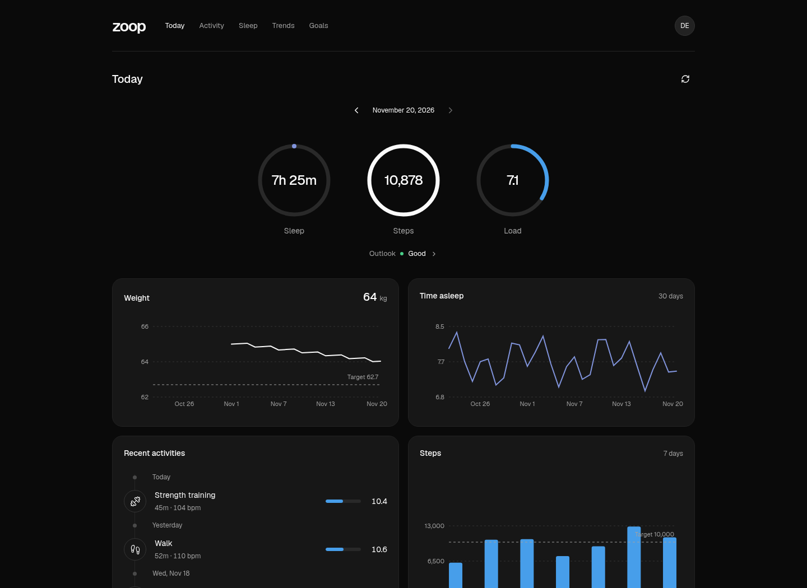
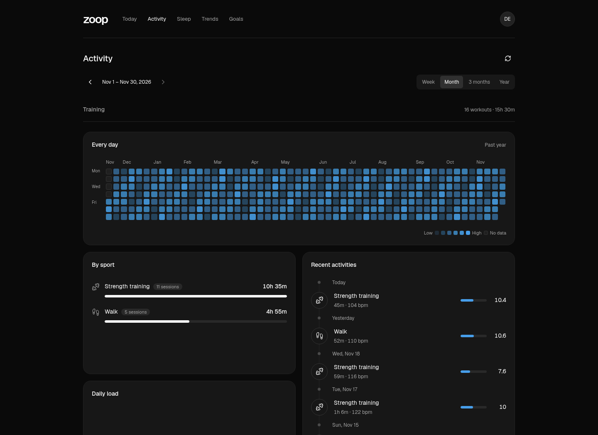
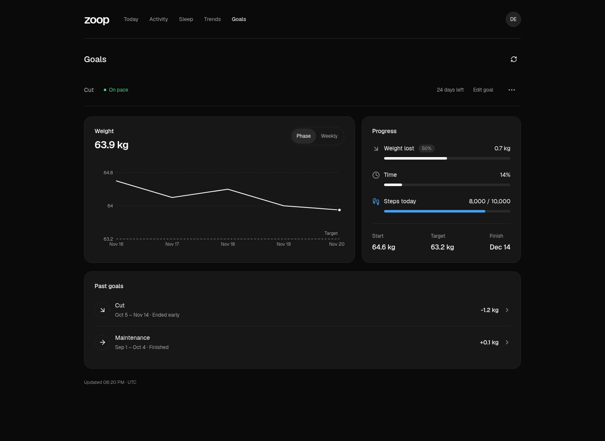

# Zoop web

**Your health history, with room to explore.**

A private web dashboard for [Zoop](../README.md).
Explore sleep, activity, weight and trends on a larger screen, manage your goals,
and keep everything on your own server.

[iPhone](../docs/IPHONE_SETUP.md) ·
[API](../server/README.md) ·
[Web dashboard](README.md)



<details>
<summary>Activity and goals</summary>




</details>

_Current UI, captured in the browser with sample data._

## What you can do

- Explore sleep, activity and weight with interactive charts and heatmaps.
- Start, edit and end cut, bulk or maintenance goals, and revisit past phases.
- Update and crop your profile photo; it follows you to the iPhone app.
- Arrange your dashboard with drag-and-drop widgets and safe chart sizes.
- Share a separate layout with selected metrics, an optional password and expiry.
- Check ingestion, processing queues and worker health with an admin account.

Each person sees their own data. Admins see operational aggregates, not other
users' health records. Measurements are read-only on the web; collection and
measurement edits happen on iPhone.

## Get started

Run the dashboard, API and PostgreSQL together with the
[Docker Compose setup](../docs/GET_STARTED.md). Open your server's address, create
your admin account and connect the [iPhone app](../docs/IPHONE_SETUP.md).
No Node or Rust installation is needed.

## How it is built

**React · TypeScript · Recharts · Nginx**

The browser renders backend-owned measurements and uses HttpOnly session cookies.
Credentials are not stored in localStorage. Fonts are bundled; the app does not
include analytics or call third-party services.

Use an account on your own Zoop server. There is no public registration or email
password-reset flow. The dashboard currently loads up to one year of history,
1,000 sleep sessions and 500 workouts, with notices when a limit is reached. These are display limits, not data retention.

## Develop locally

Use Node 24. First set up
[Zoop API](../server/README.md) with private accounts and
`web.origin = "http://127.0.0.1:5173"`, then create an account using its
[account guide](../server/docs/private-web.md).

```sh
git clone https://github.com/MakisChristou/zoop.git
cd zoop/web
npm ci
ZOOP_API_URL=http://127.0.0.1:8471 npm run dev
```

Open **http://127.0.0.1:5173** and sign in. `ZOOP_API_URL` selects the development
API upstream; without it, the proxy defaults to port 18471.

For a custom deployment, `npm run build` produces static files in `dist/`.
Serve them and proxy `/v1/` to the API on the same origin. Set the API's `web.origin`
to that exact browser address.

## Contribute

See [development and tests](docs/DEVELOPMENT.md), [CONTRIBUTING.md](CONTRIBUTING.md)
and [SECURITY.md](SECURITY.md).

[MIT license](LICENSE). Bundled fonts retain their own licenses.

## Share a dashboard

Open **Account → Shared dashboards → New dashboard**. Drag cards into the canvas,
arrange them and save. Private and shared dashboards offer the same 18 widgets,
including **Daily recovery**, sleep stages, nightly metrics, goal progress, charts
and activity heatmaps. Cards use the same appearance, interactions and safe sizes.
Existing links keep their selections.

History defaults to the **last 30 days**. **All history** includes future readings
and lets visitors browse by year; selected dates stay fixed. Links expire after
seven days by default, with a **Never expires** option. Names and photos are opt-in.
You can change the password, disable a link or delete it without changing any data.

Anyone with a working link and its password, if set, can view and copy the selected
measurements. Revocation stops new requests; it cannot recall copies already made.
Website embedding and developer API access are not part of this version.

The heatmap can use its own **1 year** history; other widgets keep the dashboard period.

Connect your own assistant through **Account → Connected agents**. [Agent setup](../docs/CONNECT_AGENT.md) covers MCP, read-only access keys and revocation.
